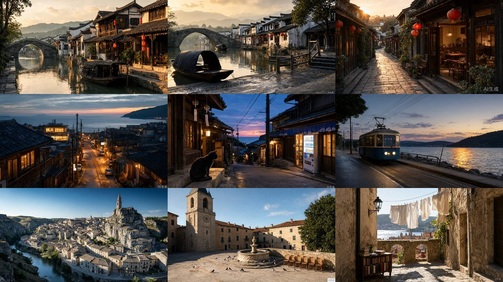
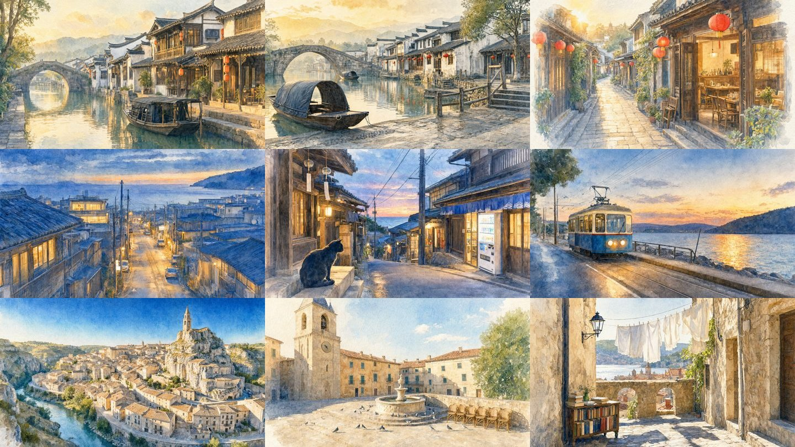
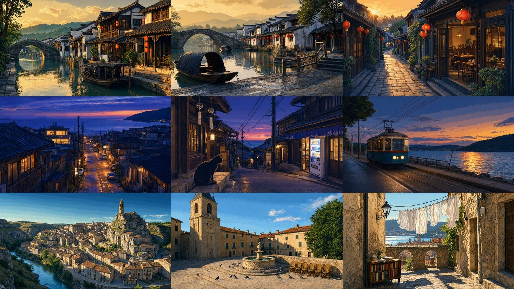

# 镇在画中

> 三座小镇,三种笔触,点街即入的网页虚拟城镇。
> 2026 Qoder 高校创造力大赛 · LifeHack 生活娱乐赛道 参赛作品。

**在线体验(公开访问,无需登录)**:https://painted-towns-f75gxhr5rba.qoder.zone

打开链接走进一座细腻的小镇:一键切换 **写实电影感 / 水彩手绘 / 复古像素** 三种笔触,点一条街道,镜头就以光斑为原点推近带你进去;点街上的光斑读一句诗意旁白,复制深链接把"某镇某街某画风"直接分享给朋友。

## 画面

三座虚构小镇,每镇 1 张全景 + 2 条街,共 9 个场景 × 3 种画风 = 27 组画面。全部由 9 张母版参考图派生,构图逐元素对齐——切换时是"同一座镇换了笔触",不是套滤镜。

| 小镇 | 意象 |
| --- | --- |
| 枕河镇 | 江南水乡:石桥、乌篷船、茶馆灯笼 |
| 汐见町 | 日式海边:坂道、贩卖机、海堤电车 |
| 钟崖堡 | 欧式山城:钟楼、石阶广场、河岸晾衣绳 |

九场景同构图对照:







## 交互

- **入镇**:首页镇卡片 FLIP 推镜入镇,镇档案浮现一句开场旁白
- **入街**:点全景街道热点,以热点为原点放大推镜;返回时反向拉远
- **故事卡**:全站 15 条诗意旁白,ESC 或点空白关闭,关闭后焦点归还触发热点
- **画风切换**:同机位交叉溶解,选择被记住并写进 URL(replaceState)
- **深链接分享**:一键复制含镇/街/画风的链接,打开即是同一画面
- **环境音**:WebAudio 程序化合成——枕河镇水声、汐见町风铃、钟崖堡教堂钟;默认静音,首次用户手势后才创建 AudioContext

## 技术

- React 19 + Vite + TypeScript,纯前端;**零动画库、零路由库**(自研 ≈60 行 hash 路由,URL 是唯一事实源)
- 动效仅 CSS `transform / opacity / filter` + Web Animations API,GPU 合成,无 WebGL
- 图片管线(sharp):裁 AI 角标 → 480/960/1600 三档 AVIF/WebP + 960 JPG 兜底 + 32px LQIP 模糊占位
- 降级四路:`prefers-reduced-motion`、`saveData`、低端设备检测、`?lite=1`;竖屏自动 contain 全图布局 + 模糊补边,保证热点可点
- 版权干净:27 组画面全部 AI 原创(母版/派生登记于 `assets-src/`),环境音程序化合成,无外部图片/字体/录音素材;不收集用户数据,偏好仅存 localStorage

**性能实测(production preview)**:首屏 332KB(红线 2MB)、CLS 0、JS+CSS 80.6KB gzip(红线 150KB)、单图 AVIF 105–235KB(红线 300KB)。

## 本地运行

```bash
npm install
npm run dev       # 开发服务器
npm run test      # vitest 单测(18 例:路由 / 数据 / 坐标映射)
npm run build     # tsc + vite build
npm run preview   # 预览生产构建
```

调试参数:`?debug=1` 点击画面输出图空间热点坐标;`?lite=1` 强制降级模式。

### 素材管线

母版与派生原图放在 `assets-src/{town}/{scene}.{style}.png`(≥1920×1080,16:9)。`public/img/**` 与 `src/data/generated/manifest.json` 一律由脚本生成,禁止手改:

```bash
node scripts/build-assets.mjs        # 裁角标 + 三档多格式 + LQIP + manifest
node scripts/make-contact-sheet.mjs  # 九宫格 QA 拼图
node scripts/annotate-hotspots.mjs   # 热点坐标核对图
```

## 目录结构

```
src/
  components/    场景视图 / 镇卡片 / 热点 / 故事卡 / 工具栏 / 镇档案 …
  data/          towns.ts(场景/热点/文案)+ styles.ts + generated/manifest.json
  lib/           转场(FLIP/推镜)、cover 坐标映射、WebAudio 环境音、预加载
  router.ts      自研 hash 路由
scripts/         素材管线与 QA 拼图
assets-src/      AI 母版与派生原图(版权登记)
docs/            研究与设计文档、验收记录、展示正文
tests/           vitest 单测
```

## 文档

- [RESEARCH.md](docs/RESEARCH.md) — 范围与取舍
- [PRD.md](docs/PRD.md) — 行为与十条验收标准
- [TECH_DESIGN.md](docs/TECH_DESIGN.md) — 架构、转场数学、性能预算、里程碑
- [QA.md](docs/QA.md) — 已验证项与真机待验项、环境限制记录
- [SHOWCASE.md](docs/SHOWCASE.md) — 参赛展示正文(含完整开发过程截图)
- [AGENTS.md](AGENTS.md) — AI 编码代理指令(依赖白名单、动效与性能铁律)

## 许可与声明

画面全部由 AI 原创生成,环境音为程序化合成,无第三方素材。作品以参赛展示为目的部署于 Qoder Sites;如需引用画面或代码,请先联系仓库所有者。